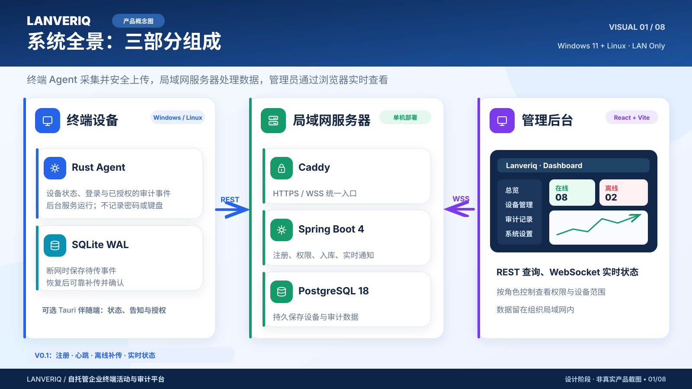

# Lanveriq（澜维巡）

[English](README.md) | **中文**

**基于局域网、自托管、面向已告知且经过授权的企业终端的资产健康与审计平台。**

> **当前状态：V0.1 开发中，不是可正式部署的监控产品。** Java 后端已有可构建的 Spring Boot 应用、Flyway V1–V8 和默认关闭的部分内部能力；Rust Agent 已有可运行的**空闲进程**、SQLite/传输/库存模块，但尚未接入实际服务循环；**React 前端已有合成数据预览，但尚未连接真实登录、后端 API 或设备**。PostgreSQL 18.6 真实数据库、Caddy/TLS、管理员浏览器会话及 Windows/Linux 实机验收尚未全部完成。严禁把本地演示当成真实员工数据采集授权。



## 一、项目包含哪些服务？

**三个业务组件**是前端、后端和终端 Agent。数据库与代理是它们的**部署依赖**，不是已经完工的三个业务应用。

| 组件 | 仓库位置 / 技术 | 当前状态 | 运行方式 |
|---|---|---|---|
| 管理前端 Web | `apps/web`：React 19、Vite 8、TypeScript 7、pnpm、Tailwind 4、Radix、Lucide | **合成数据预览已实现**：概览、监控中心、终端资产/详情、注册说明、设置；真实 API 尚未接入 | `cd apps/web && pnpm dev`（本机预览） |
| 管理后端 Server | `apps/server`：Java 25、Spring Boot 4.1.2、Gradle、JPA/Hibernate、Flyway | 可单独构建并连接**合成测试数据库**；业务接口默认拒绝，部分功能仅源码/测试状态 | `./gradlew bootRun` |
| 终端 Agent | `apps/agent`：Rust 1.94、Tokio、SQLx/SQLite WAL、Reqwest/rustls | 可编译、启动、停止；运行时**不采集、不上传、不监控** | `cargo run --locked -p lanveriq-agent -- --config <绝对路径>` |
| 数据库（基础设施） | PostgreSQL 18.x；真实验收使用 18.6 | Flyway V1–V8 已编写；可复用 `spark-postgres` 中的专用 `lanveriq` 库 | 现有 Docker Compose，无需额外持久容器 |
| Redis（可选基础设施） | `spark-redis` / Redis 8 / Spring Data Redis + Lettuce | 短期非权威提示与健康检查，**默认关闭**；不存储会话、权限、审计、ACK | 复用现有 Redis，不创建新容器 |
| HTTPS 代理（基础设施） | Caddy | `deploy/caddy/Caddyfile.reference` **仅为安全测试参考配置**，不能直接用于生产 | 正式部署方案待验收 |

设计目标：在服务器使用 **Caddy（HTTPS/静态前端）→ Spring Boot → PostgreSQL**，在已授权的 Windows/Linux 终端原生运行 Rust Agent。**Agent 不应部署在服务器 Docker Compose 中。** 前端静态资源最终可由 Caddy 托管，不需要额外的 Next.js 服务。详细设计见 [部署架构](docs/architecture/deployment.md)。

## 二、准备环境

- Git；**JDK 25**；仓库自带 **Gradle 9.8.2 Wrapper**（无需 Maven，也无需单独安装 Gradle）。
- Rust **1.94.0**（见 `rust-toolchain.toml`）、Cargo；按目标系统安装相应的 Rust 原生构建工具。
- Docker Engine 和已运行的 `spark-db` PostgreSQL 可直接用于独立数据库的本地开发；只有需要**独立合成数据验收**时，才额外启动短期 PostgreSQL 18.6 容器。首次下载依赖/镜像可能需要联网；未来产品运行目标是离线局域网。
- Bash、curl、OpenSSL，用于现有 Linux/WSL/macOS 开发环境下的服务器自检脚本。生产服务器及 Agent OS 服务还需要单独验收。
- 本地 Web 合成预览需要 **Node.js 24 + pnpm 12**；独立的 `apps/server/contract-client-check` 仍只用于 Orval 契约验证，尚未与 Web 联调。

克隆仓库：

```bash
git clone https://github.com/kunlong-luo/lanveriq.git
cd lanveriq
```

## 三、本地运行：直接复用已有 spark-db

你提供的 Compose 工程名为 `spark-db`，其中 PostgreSQL 容器是 `spark-postgres`；默认通过 `127.0.0.1:5432` 暴露，原有业务库名为 `iot_farm`。**无需新建 PostgreSQL 容器；可选择复用现有 `spark-redis`，但不依赖 InfluxDB 或 PostGIS 扩展。**

**隔离原则：** 在同一个 PostgreSQL 实例里创建独立的 `lanveriq` 数据库与 `lanveriq` 普通登录角色；Flyway 只迁移这套新库。不要把 `iot_farm` 作为 `LANVERIQ_DB_URL`，不要使用共享的 `root` 超级用户运行 Lanveriq，也不要修改或卸载现有 `spark-db` Compose/数据卷。此流程只能在已授权、没有真实员工数据的本地开发环境操作。

### 1. 检查现有数据库，不重启 Compose

在运行 Docker 的电脑上：

```bash
docker inspect -f '{{.State.Running}}' spark-postgres
docker port spark-postgres 5432
docker exec spark-postgres psql -U root -d postgres -XAtc "SHOW server_version;"
```

第一条应输出 `true`，第二条需要确认显示宿主机 `127.0.0.1:5432`（若你改过 `BIND_IP` / `POSTGRES_HOST_PORT`，以实际映射为准）。**镜像标签 `postgis/postgis:18-3.6` 仅表示 PostgreSQL 18 系列；是否为 18.6 必须以 `SHOW server_version` 为准。** 你的 Compose 还有 InfluxDB Explorer 占用宿主机 **18080**，所以 Lanveriq 使用 **18081**，不要覆盖它。

如果 Compose 使用的超级用户名不再是 `root`，请在以上检查命令中替换为你实际配置的管理员角色。注意：**不会在这一步自动启动、停止、更新或修改现有服务。** 你提供的 Compose 示例含有弱默认数据库/Redis 密码；如果已经实际启用，建议在独立维护窗口内轮换，文档不会复制这些密码。

### 2. 只为 Lanveriq 创建新账号和数据库（首次一次）

使用 PostgreSQL 自带的 `psql`，经 Docker 的本地 Unix socket 进入管理控制台：

```bash
docker exec -it spark-postgres psql -U root -d postgres
```

先在 `psql` 中用 `\du`、`\l` 确认 `lanveriq` 角色和数据库尚不存在；如果已经存在，应确认所有权、历史迁移和用途，**不要盲目重建或覆盖**。对全新、未使用的名称执行：

```sql
CREATE ROLE lanveriq LOGIN NOSUPERUSER NOCREATEDB NOCREATEROLE NOREPLICATION;
```

随后在**同一个交互式 psql 会话**输入 `\password lanveriq`，在隐藏输入提示中设置独立且强度足够的密码，避免把密码写进 Git、Compose 文件或命令历史。再创建数据库：

```sql
CREATE DATABASE lanveriq OWNER lanveriq;
```

用 `\q` 退出。**不要**对 `iot_farm` 执行 Lanveriq 的 Flyway，也不要给 `lanveriq` 用户超级用户权限。此新库不需要 `postgis`、`pg_cron`、`pg_stat_statements` 或 InfluxDB；Redis 是独立的可选缓存依赖，不属于 PostgreSQL 扩展。由于你当前 PostgreSQL 内存上限较低（示例为 256 MiB），并行运行多套数据库负载可能资源不足；不要通过取消共享服务的安全限制来掩盖问题。

### 3. 启动 Java 后端（本地开发）

在仓库根目录进入后端；用隐藏终端输入读取**刚刚为新角色设置的**密码：

```bash
cd apps/server
export LANVERIQ_DB_URL='jdbc:postgresql://127.0.0.1:5432/lanveriq'
export LANVERIQ_DB_USER='lanveriq'
read -rsp 'Lanveriq PostgreSQL password: ' LANVERIQ_DB_PASSWORD
echo
export LANVERIQ_DB_PASSWORD
export LANVERIQ_HTTP_BIND='127.0.0.1'
export LANVERIQ_HTTP_PORT='18081'
# 业务开关一律保持默认 false；不要启用真实设备接入。
./gradlew bootRun
```

以上命令适用于后端程序运行在**与 Docker 端口映射相同的宿主机**的 Bash 终端。Windows PowerShell、WSL2、远程开发机或后端在另一容器里运行时，`127.0.0.1` 所指的机器可能不同；必须先独立验证网络可达性，**不能为了方便把共享 PostgreSQL 暴露到 0.0.0.0**。宿主机环境变量在进程存活期间包含数据库密码，仅可用于受信任的本地开发会话；正式环境应使用受保护的密钥注入方式。

另一个终端检查：

```bash
curl -fsS http://127.0.0.1:18081/actuator/health
curl -i http://127.0.0.1:18081/api/v1/devices
```

健康检查预期 `{"status":"UP"}`，无权限业务请求预期 **403**。首次启动 Flyway 会在**专用的 `lanveriq` 数据库**创建 V1–V8 的表与约束。注意：`/actuator/health` 显示 UP **不代表**管理员网页、Agent HTTP 上传、浏览器登录或 PostgreSQL 全量集成测试通过。此开发 HTTP 只能绑定 loopback，不得直接公开给局域网。

停止后端：在 `bootRun` 终端按 `Ctrl+C`。**不要执行** `docker stop spark-postgres`、`docker compose down` 或 `docker compose down -v`：它们可能影响 `iot_farm`、其他数据库及 Redis/InfluxDB 的服务与数据卷。

### 4. 可选：启用已有 Redis 8（不新增 Redis 容器）

后端**默认不依赖 Redis**。若希望在已授权的本地合成测试环境启用它，先检查：

```bash
docker inspect -f '{{.State.Running}}' spark-redis
docker port spark-redis 6379
```

默认应通过宿主机 `127.0.0.1:6379` 访问。保持 `spark-redis` 原有容器和数据卷不变。在**启动 Java 后端的同一个 Bash 终端**、执行 `./gradlew bootRun` **之前**，设置：

```bash
export LANVERIQ_REDIS_HOST='127.0.0.1'
export LANVERIQ_REDIS_PORT='6379'
read -rsp '现有 spark-redis 密码: ' LANVERIQ_REDIS_PASSWORD
echo
export LANVERIQ_REDIS_PASSWORD
export LANVERIQ_REDIS_ENABLED='true'
./gradlew bootRun
```

密码必须使用现有 Compose 的真实配置值（不要复制 README 或 Compose 示例中的弱默认密码），不得提交到仓库。启用后 Redis 可参与 `/actuator/health` 健康检查；当 Redis 不可达时，健康状态可能为 DOWN。当前仅提供内部的 **90 秒 UUID 变更提示能力，尚未接入业务调用**，不会因此启动设备采集、远程操作或新的 HTTP 接口。

现有 Redis 使用 `allkeys-lru`，可能随时淘汰键，因此**不能**存储权威会话、权限、审计、设备 ACK 或分布式锁；真实数据始终以 PostgreSQL 和经授权的 REST 查询为准。停止 Lanveriq 仅结束 Java 进程，**不要停止 `spark-redis`、执行 `FLUSHALL` / `FLUSHDB`、清理 Redis 卷或执行 Compose down。**

### 5. 可选：独立一次性 PostgreSQL 18.6 自检（不会触碰 spark-db）

如果想跑仓库既有的自动清理脚本，而不是用共享实例，它会另启**临时** `postgres:18.6` 容器，不操作 `spark-postgres`。为避开 InfluxDB Explorer 的 18080 端口，运行：

```bash
# 先停止占用 18081 的 Lanveriq 后端；这里使用独立 HTTP 端口 18082。
LANVERIQ_SMOKE_HTTP_PORT=18082 \
LANVERIQ_SMOKE_DB_PORT=55432 \
bash apps/server/scripts/verify-postgres18.sh
```

自检会生成临时数据库密码、在 `127.0.0.1:55432` 建立独立容器、运行 Spring Boot、验证 Flyway/默认拒绝，然后清理**自己创建**的容器和临时文件。这不是正式部署，也不代表全套 58 个 PostgreSQL 集成测试已通过。数据库集成测试仍必须使用隔离的 Testcontainers，并取得真实执行证据；**不得将会清空测试表或创建临时触发器的集成测试指向你的共享 `iot_farm` 或 `lanveriq` 开发库。**

### 本地运行 Rust Agent（只启动空闲循环）

在仓库根目录执行：

```bash
cargo test --workspace --locked
cargo build --release --locked -p lanveriq-agent
cp apps/agent/config/agent.example.toml /tmp/lanveriq-agent-demo.toml
cargo run --locked -p lanveriq-agent -- \
  --config /tmp/lanveriq-agent-demo.toml
```

配置文件必须是**绝对路径**，内容是纯合成/无密钥配置。按 `Ctrl+C` 退出；结束后可手动删除你创建的 `/tmp/lanveriq-agent-demo.toml`。此程序目前**不会**向后端发送心跳、读取设备库存或执行监控。Windows 11 可在 PowerShell 中使用：

```powershell
Copy-Item .\apps\agent\config\agent.example.toml "$env:TEMP\lanveriq-agent-demo.toml"
cargo run --locked -p lanveriq-agent -- --config "$env:TEMP\lanveriq-agent-demo.toml"
```

这是前台进程检查，**不是 Windows SCM 服务安装**。

### 本地测试命令

```bash
# 仓库根目录：Rust（真实单元测试，合成数据）
cargo test --workspace --locked
cargo fmt --all -- --check
cargo clippy --workspace --all-targets --locked -- -D warnings

# Java：单元测试、构建、编译 PostgreSQL 集成测试代码（不启动 Docker）
cd apps/server
./gradlew test bootJar compileIntegrationTestJava
```

数据库集成测试是**另外的手动门槛**：`cd apps/server && ./gradlew --no-build-cache --rerun-tasks integrationTest`，必须在明确授权的隔离 Docker 环境中使用合成数据。真正通过还需要验证 7 类至少 58 个用例、零失败/跳过，并运行 JUnit 证据校验器；**当前尚无成功的真实 PostgreSQL 18.6 执行记录**。参见 [PG18 手动验收](docs/testing/server-postgres18-manual.md) 与 [GitHub 手动工作流](https://github.com/kunlong-luo/lanveriq/actions/workflows/server-postgres18-integration.yml)。

## 四、部署：当前能够做什么？

### 实验性部署（仅获授权的测试机）

服务端仍只能作为开发 Java 进程运行，Web 已有可构建的本地合成数据预览，但**没有**正式 Docker Compose、生产 Caddy 配置、真实登录或可操作的管理界面。不能执行尚不存在的 `docker compose up -d` 来安装整套产品。

### Java 后端构建部署包（仅隔离测试，不是生产部署）

如果不想使用 `bootRun`，可以在完成上文数据库变量配置的**同一受信任终端**构建并前台运行 JAR：

```bash
cd apps/server  # 如果已经在 apps/server 中，请省略这一步
./gradlew bootJar
java -jar build/libs/lanveriq-server-0.1.0-SNAPSHOT.jar
```

仍连接你的 `127.0.0.1:5432/lanveriq`，仍绑定 `127.0.0.1:18081`，仍默认关闭业务功能。退出按 `Ctrl+C`。JAR 属于试验性构建物，**不是**已通过 Caddy/TLS、真实浏览器及数据库集成验收的生产服务；不要用 `nohup` 或自动开机来绕过这些门槛。

Linux 的 Rust Agent 仅提供**实验性 systemd 单元** `deploy/systemd/lanveriq-agent.service`。如果你拥有一台**隔离的测试 VM**并明确允许安装一个不采集数据的空闲服务，可在仓库根目录先构建，再手动安装：

```bash
cargo build --release --locked -p lanveriq-agent
sudo install -m 0755 target/release/lanveriq-agent /usr/local/bin/lanveriq-agent
sudo install -d -m 0755 /etc/lanveriq-agent
# 本例配置没有密钥；未来存放密钥的配置不能使用 0644 权限。
sudo install -m 0644 apps/agent/config/agent.example.toml /etc/lanveriq-agent/agent.toml
sudo install -m 0644 deploy/systemd/lanveriq-agent.service /etc/systemd/system/lanveriq-agent.service
sudo systemd-analyze verify /etc/systemd/system/lanveriq-agent.service
sudo systemctl daemon-reload
sudo systemctl start lanveriq-agent
sudo systemctl --no-pager status lanveriq-agent
```

**不执行 `systemctl enable`，不自动开机启动。** 此参考单元还需要在目标 Linux/systemd 上进行真实权限与停止测试。Windows 端有 SCM dispatcher 源码，但没有受验收的安装器、卸载器或正式服务安装命令。参见 [Agent 生命周期验收](docs/testing/agent-lifecycle-manual.md)。

### 正式生产部署：尚不可执行

计划采用 **Caddy + Spring Boot + PostgreSQL** 的中心端部署和静态 React 前端、独立 Windows/Linux 原生 Agent。正式部署前至少需要：

1. 完成 `apps/web`、构建并验证真实登录/设备列表/监控总览页面。
2. 提供经审查的 Compose、专用数据库卷与备份/恢复、保密配置和受限网络；PostgreSQL 不对局域网发布端口。
3. 验收 Caddy HTTPS、控制台 Host/Origin/CSRF/cookie、独立 Agent mTLS/上游 TLS 信任边界、证书轮换与密钥保存。
4. 完成 PostgreSQL 18.6 的 **7 类 / 至少 58 用例**真实集成测试，以及 Windows/Linux 安装、停用和权限验收。
5. 获得组织/法律要求的员工告知、数据字段、留存、访问权限批准和恢复演练。

**任何真实设备注册、采集、自动上传、活动审计或屏幕录像都不能仅靠打开开发开关部署。** 更多信息见 [安装运维方案](docs/operations/installation.md)、[安全与隐私](docs/security/privacy-and-consent.md) 和 [部署架构](docs/architecture/deployment.md)。

## 五、停止与卸载

| 对象 | 停止 / 卸载方式 | 数据与安全提醒 |
|---|---|---|
| 本地 Spring Boot | 在 `bootRun` 终端按 `Ctrl+C` | 不会自动删除 PostgreSQL 数据 |
| 共享 `spark-postgres` | **不停止、不卸载、不执行 Compose down** | `iot_farm`、Redis、InfluxDB 与持久卷必须保留；仅独立管理 `lanveriq` 库 |
| 前台 Agent | `Ctrl+C` | 删除自己创建的临时 TOML 即可 |
| Linux 实验性 Agent systemd | 见下方命令 | 只删除由本 README 示例安装的文件 |
| Windows SCM Agent | 目前**没有**正式安装/卸载包 | 若已手动注册测试服务，须先按实际服务名停止、删除 SCM 服务，并经管理员确认后清理二进制/配置 |
| Web 本地预览 | 在 `pnpm dev` 终端按 `Ctrl+C` | 可清理本地生成的 `apps/web/node_modules` 与 `apps/web/dist`，不得触碰共享 Docker 数据卷 |
| 正式中心端 | **尚未提供一键卸载** | 后续必须先备份、验明数据所有者、遵守留存/审计与密钥撤销流程 |

**仅当你已在测试 VM 按上节命令安装 systemd 服务时**，执行以下卸载（先确认没有其他应用在使用这些路径）：

```bash
sudo systemctl stop lanveriq-agent
sudo systemctl disable lanveriq-agent  # 仅当曾经启用开机启动
sudo rm /etc/systemd/system/lanveriq-agent.service
sudo systemctl daemon-reload
sudo rm /usr/local/bin/lanveriq-agent
sudo rm /etc/lanveriq-agent/agent.toml
sudo rmdir /etc/lanveriq-agent
```

这里**不会自动删除**任何 SQLite WAL、服务状态目录、数据库卷、证书、审计或备份数据。真实数据的删除需要单独的授权、保留政策和审计记录；不要直接删除 `/var/lib`、数据库卷或其他路径来“彻底卸载”。

### 只卸载 Lanveriq 的独立数据库（可选，破坏性操作）

**停止 Lanveriq 后端不需要删除数据库。** 如果确实要彻底清除**仅供测试且不需要保留**的 `lanveriq` 数据，先确认管理员授权、保留政策和备份，再针对**唯一的 Lanveriq 数据库**操作。备份命令会把数据库导出到当前目录，请把备份置于受限、加密的存储中：

```bash
umask 077
docker exec spark-postgres pg_dump -U root -d lanveriq -Fc > lanveriq-backup.dump
```

确认备份有效并停止所有连接 `lanveriq` 的应用后，**只能人工决定是否执行以下不可逆的 SQL**。使用 `docker exec -it spark-postgres psql -U root -d postgres` 进入与待删除库不同的 `postgres` 管理库，先运行 `\l`、`\du` 核对目标，然后：

```sql
-- 仅在确认 lanveriq 是专门创建、可删除的测试数据库后执行。
DROP DATABASE lanveriq;
-- 仅在此角色没有被其他数据库/服务复用时执行。
DROP ROLE lanveriq;
```

**绝对不要删除 `iot_farm`、停止 `spark-postgres` 或清理 `postgres-data` 卷。** 你的原有 pg_dump/Kopia/R2 备份设置可能只覆盖 `iot_farm`；不要假设它已包括新建的 `lanveriq` 数据库，需单独核实。

## 六、Web 本地预览运行

React Web 已可作为**仅有合成数据**的前端预览启动（不需要后端或 Docker）。首次安装依赖需要访问包仓库：

~~~bash
cd apps/web
corepack enable
corepack prepare pnpm@12.0.0 --activate
pnpm install --frozen-lockfile
pnpm test
pnpm build
pnpm dev
~~~

浏览器打开 **http://127.0.0.1:5173**，按 `Ctrl+C` 停止。`apps/web/pnpm-lock.yaml` 已由 CI 生成并提交，Web CI 使用 `--frozen-lockfile` 进行可复现安装，发现锁文件与声明依赖不一致会直接失败。页面包括 `/overview`、`/monitoring`、`/devices`、设备详情、`/enrollment` 和 `/settings`。真正的注册、撤销、Agent 下发都明确禁用。详见 [Web README](apps/web/README.md)。

## 七、前端进度和下一步

截至当前仓库检查：**`apps/web` 已建立并完成可构建的合成数据演示页面**，包括设备搜索、Radix 详情选项卡、监控中心与系统设置；全部示例设备均为虚构，不连接真实服务，也不能进行远程下发或设备撤销。后端 Springdoc → Orval 契约验证工程 `apps/server/contract-client-check` 尚未与前端 API 联调。前端规划见 [设计系统](docs/development/frontend-design-system.md) 与 [管理后台 UX](docs/development/dashboard-ux.md)。

建议的后续交付顺序是：完善 Web 的冻结依赖锁与 UI 测试，落实真实 PG18、Caddy/TLS 与浏览器会话负向验收，然后才接入经授权且默认关闭的后端 API。验收前不可对外宣布“可安装并开始监控”。

## 八、文档与许可

[文档索引](docs/README.md) · [需求](docs/product/requirements.md) · [开发路线](docs/planning/roadmap.md) · [安全](SECURITY.md) · [贡献指南](CONTRIBUTING.md) · [设计图库](docs/visuals/README.md)

当前仓库**尚未提交正式软件 LICENSE**；公开可见不代表授予使用或再分发权。详见 [D0 治理决策](docs/governance/d0-decision-package-2026-10-30.md)。

Copyright (c) 2026 Lanveriq contributors.
