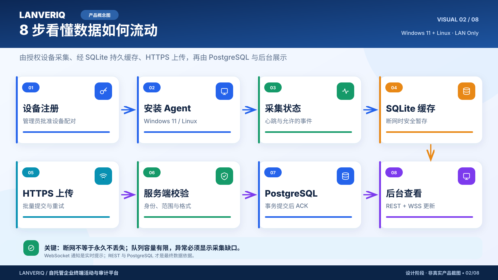
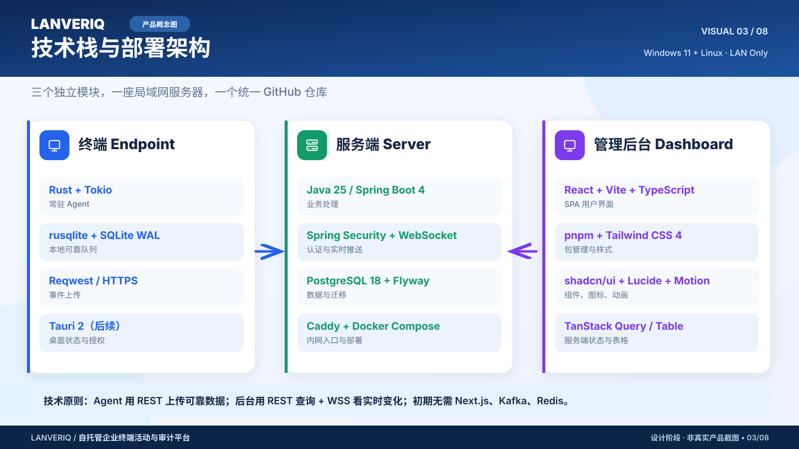
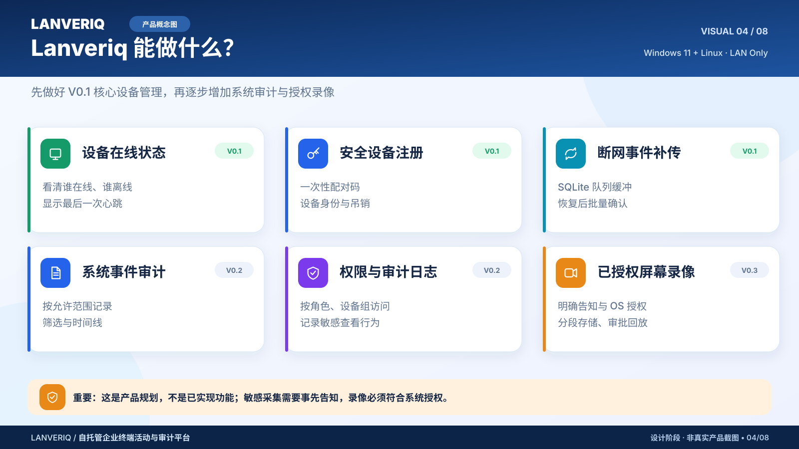
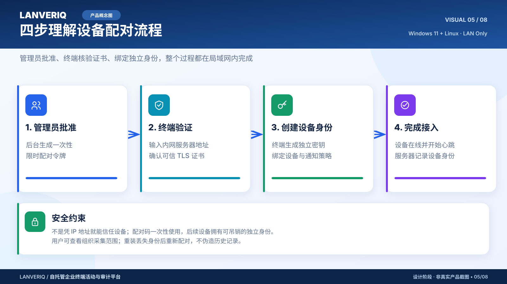
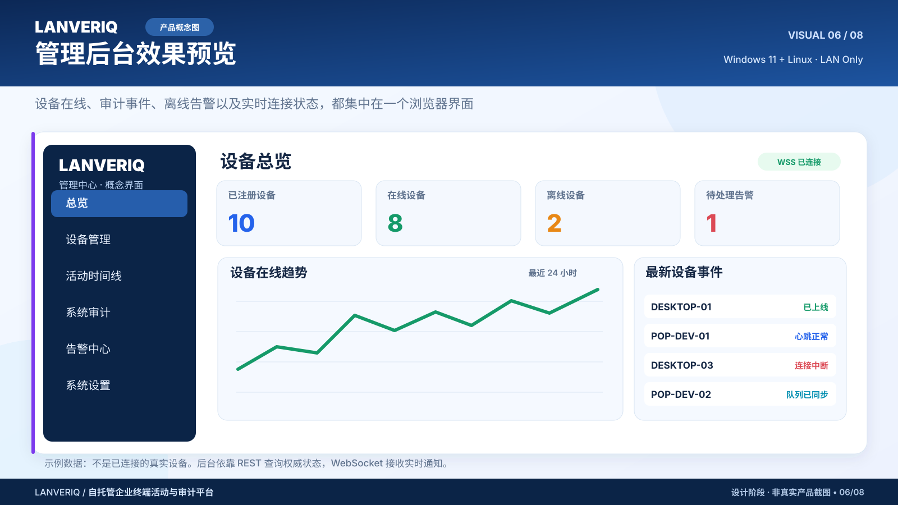
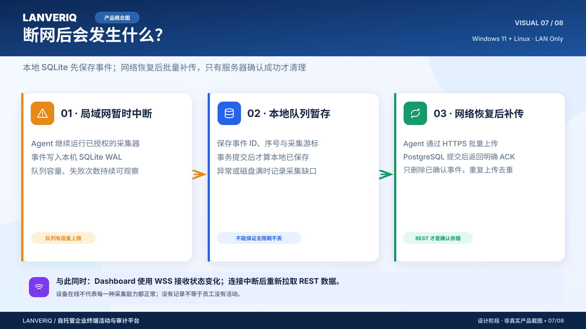
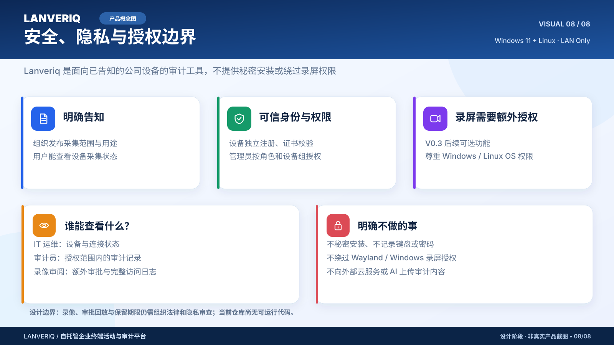

# Lanveriq · 用户可视化图库 / Product Visual Gallery

**Eight coordinated, editable color SVG infographics** for explaining the product to non-engineers. All artwork lives **inside this repository**. These are **concepts**, not screenshots of a running Lanveriq product. Source files: [assets/](assets/).

> 设计阶段：以下界面、数据和操作流程都是示意，不代表软件已安装或功能已实现。V0.3 录像须经过明确告知及操作系统授权。

| 01 · 系统总览 / Overview | 02 · 数据流程 / Data flow |
|:---:|:---:|
|  |  |
| [查看原图](assets/01-overview.svg) · 三个主要模块 / V0.1 | [查看原图](assets/02-data-flow.svg) · 注册、缓存、上传、查看 / V0.1 |

| 03 · 技术栈 / Tech stack | 04 · 功能路线 / Feature map |
|:---:|:---:|
|  |  |
| [查看原图](assets/03-technology-stack.svg) · pnpm、React/Vite、Java、Rust | [查看原图](assets/04-feature-map.svg) · V0.1 / V0.2 / V0.3 |

| 05 · 安全配对 / Enrollment | 06 · 管理后台 / Dashboard |
|:---:|:---:|
|  |  |
| [查看原图](assets/05-enrollment.svg) · 一次性配对、可信证书 / V0.1 | [查看原图](assets/06-dashboard-concept.svg) · **界面及数字均为模拟** / V0.1 |

| 07 · 断网恢复 / Recovery | 08 · 安全隐私 / Security |
|:---:|:---:|
|  |  |
| [查看原图](assets/07-offline-recovery.svg) · 有界队列、PostgreSQL ACK / V0.1 | [查看原图](assets/08-security-and-privacy.svg) · 最少必要采集、告知、授权 |

## Source of truth and editing

- [Visual style guide](STYLE_GUIDE.md): 16:9 canvas, colors, fonts, icons, illustration patterns, accessibility, text limitations.
- [Asset manifest](ASSET_MANIFEST.md): IDs, intent, stages, use sites and file ownership.
- [Content and terminology consistency matrix](CONTENT_MATRIX.md): exact architecture semantics, feature stages, user notice and prohibited claims.
- [Engineering architecture diagrams](../diagrams/README.md): the separate, developer-oriented Mermaid drawings. **Keep both sets**; color posters are explanations, Mermaid diagrams are technical contracts.
- [Technology selection](../development/technology.md) and [development roadmap](../planning/roadmap.md) determine the actual product, not decorative infographic text.

## Asset policy

The initial three generated raster concept posters were **reillustrated as standardized editable SVGs (01–03)**; 04–08 complete the coordinated set. The repo-managed SVG series is the canonical project visual version, rather than an untracked bitmap. Each vector is 1600×900, self-contained (no scripts, remote URLs, or embedded fonts), previewable in GitHub, and readable without a proprietary editor. **No employee personal data, real device screenshots or real endpoint records** are included.

When requirements change, update the canonical technical document **and** affected poster(s) in the same small `main` commit. Keep old drawings only when intentionally versioned, not as contradictory duplicates.

The repository has not yet chosen its software/artwork license; public readability does not by itself grant re-use rights.
